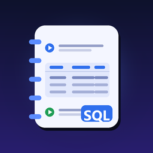
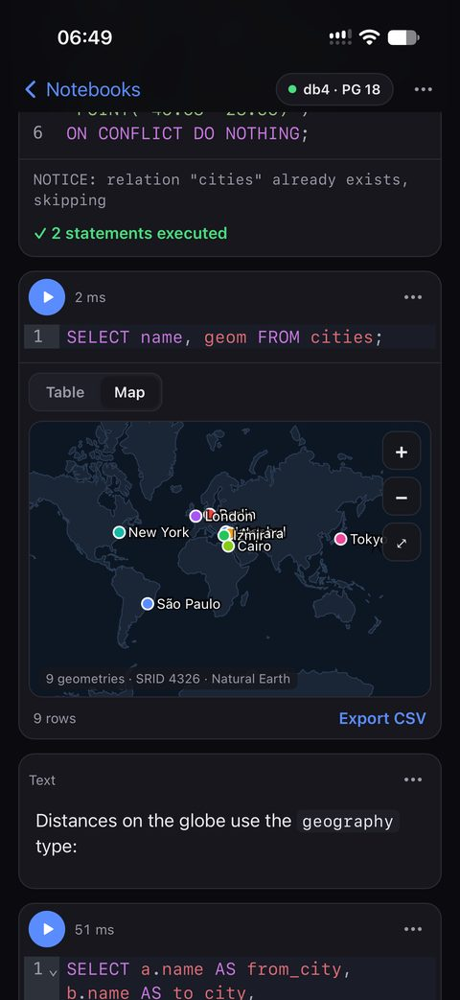
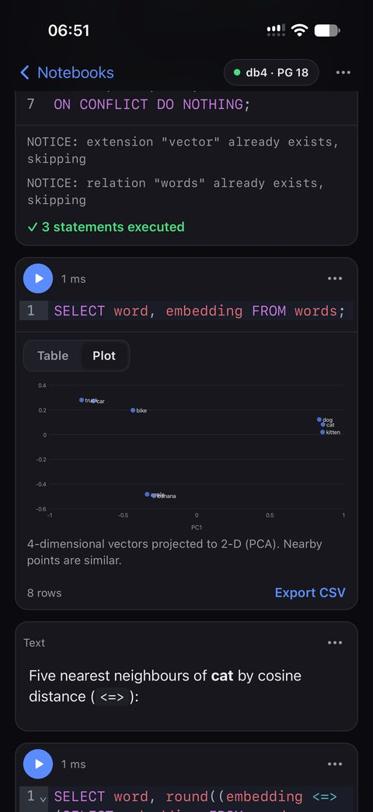
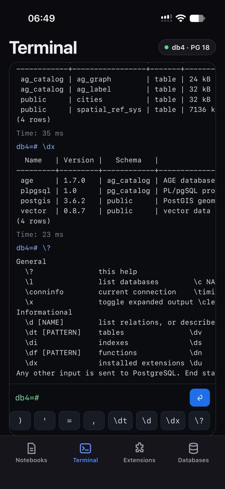
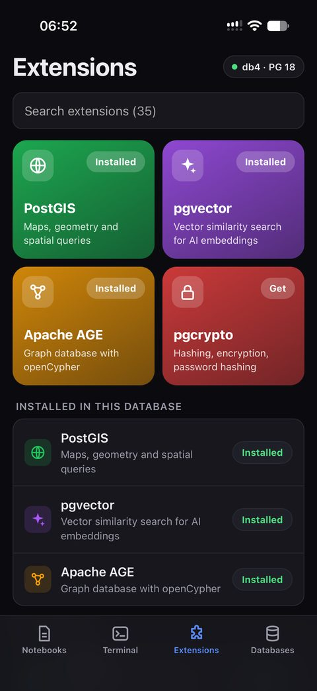
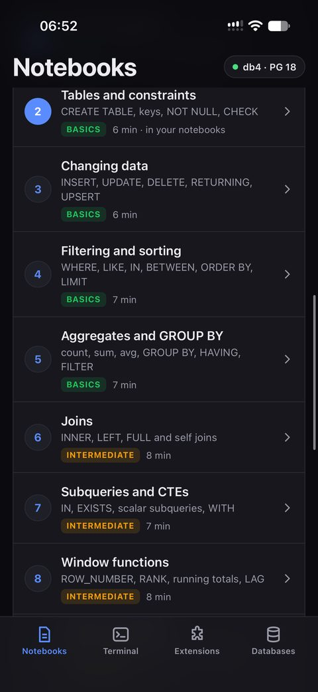

<p align="center">
  
</p>

<h1 align="center">Tuple: PostgreSQL on your iPhone</h1>

<p align="center">
  <b>A real PostgreSQL 18 server that runs on your iPhone, offline.</b><br>
  PostGIS maps, pgvector search, Apache AGE graphs, a psql terminal and Jupyter-style SQL notebooks.<br>
  No server, no network, no account.
</p>

<p align="center">
  <a href="https://apps.apple.com/us/app/tuple-sql-notebook/id6835658208"></a>
</p>

<p align="center">
  
  
  
  
  
</p>

**[Get Tuple on the App Store](https://apps.apple.com/us/app/tuple-sql-notebook/id6835658208)**: free, with a one-time Pro purchase for the extensions.
Tuple is to PostgreSQL what Juno is to Python: you write SQL in cells, run them, and see the results as
tables, charts and maps. Everything stays on the device.

## Run PostgreSQL locally on iPhone and iPad

**How do I run PostgreSQL on my iPhone?** Install [Tuple](https://apps.apple.com/us/app/tuple-sql-notebook/id6835658208)
and open it. A PostgreSQL 18 server starts on the device in milliseconds; there is nothing to configure and no
server to connect to. Create tables, load data and query it in notebook cells or in the psql-style terminal.

**Is it a client for a remote database?** No. Tuple is not a client: the database itself runs on your phone,
compiled to WebAssembly ([PGlite](https://pglite.dev)). It works in flight mode.

**Can I use PostGIS, pgvector or Apache AGE on iOS?** Yes, they are bundled in the app (Pro): PostGIS with
geometry results drawn on an offline world map, pgvector for similarity search with a 2-D plot of embeddings,
and Apache AGE for graph queries in openCypher. 30+ extensions in total.

**Which PostgreSQL version?** PostgreSQL 18, 17 or 16, chosen per database. Several databases can live side by
side, each with its own extensions.

**Can I practise SQL for interviews or a course on my phone?** Yes: free lessons go from `SELECT` to joins,
CTEs and window functions, each one a notebook you can edit and run.

**Where is my data?** Only on your device. Notebooks are `.ipynb` files in *Files › On My iPhone › Tuple*, and
the whole database can be backed up and restored as a `.tar.gz`.

## Features

- **Real PostgreSQL 18** (also 17 and 16) via [PGlite](https://pglite.dev), running in a background worker so the UI stays responsive.
- **Notebooks**: SQL and Markdown cells, run one or *Run all*, results as tables, bar, line and scatter charts, maps for PostGIS, NOTICE output, timings, CSV export of any result.
- **psql-style terminal** with `\d`, `\dt`, `\dx`, `\df`, `\l`, `\c`, `\x`, `\timing` and history.
- **Jupyter compatible**: notebooks are stored as `.ipynb` files (SQL kernel). Import `.ipynb` or `.sql`, share as either.
- **Extensions** bundled in the app (nothing is downloaded): PostGIS, pgvector, Apache AGE, pgcrypto, pg_trgm,
  hstore, ltree, citext, uuid-ossp, pg_uuidv7, pg_hashids, tablefunc, pg_ivm, pgmq, pgTAP, pg_textsearch,
  btree_gin/gist, bloom and more.
- **Autocomplete** for keywords, tables, columns and functions of your database.
- **Backups**: export the whole database as a `.tar.gz`, restore it later or on another device.
- **Free lessons**: learn SQL from zero to window functions.
- SQL symbol bar above the keyboard, light and dark mode, English and Turkish.

Also by the same developer: **[Querly](https://github.com/heyobi/querly)**, a CSV, Excel and JSON viewer with
charts and DuckDB on iPhone, iPad and iPhone Duo.

## How it works

```
iOS app (Capacitor, WKWebView)
 ├─ UI: TypeScript + CodeMirror 6           src/main.ts
 ├─ Web Worker: PGlite + extensions         src/pg.worker.ts
 ├─ Snapshot of PGDATA (gzip tar)           Library/pgnotebook/main.tar.gz
 └─ Notebooks (.ipynb)                      Documents/Notebooks/
```

App Store rules allow apps to run code the user writes, as long as the interpreter ships inside the app and no
executable code is downloaded. PostgreSQL and every extension are compiled to WebAssembly and bundled; the app
makes no network requests.

## Develop

```bash
npm install
npm run dev        # http://localhost:5199 — the whole app runs in a desktop browser too
npm test
npm run cap:sync   # build and copy into ios/ (open ios/App/App.xcodeproj in Xcode on a Mac)
```

## Release (GitHub Actions → TestFlight)

`.github/workflows/ios-testflight.yml` builds every push to `main` on a macOS runner, signs it and uploads it to
App Store Connect. Repository secrets it needs:

| Secret | What |
|---|---|
| `APP_STORE_CONNECT_KEY_ID`, `APP_STORE_CONNECT_ISSUER_ID`, `APP_STORE_CONNECT_PRIVATE_KEY` | App Store Connect API key (.p8 contents) |
| `BUILD_CERTIFICATE_BASE64`, `P12_PASSWORD` | Apple Distribution certificate (.p12, base64) and its password |
| `KEYCHAIN_PASSWORD` | Any random string for the temporary CI keychain |

The workflow registers the bundle ID and creates the App Store provisioning profile itself; the App Store
Connect app record must exist (bundle ID `com.heyobi.pgnotebook`).

## Roadmap

- `COPY FROM` a CSV picked in Files
- EXPLAIN plan visualiser
- Go and other languages as sibling apps

## Licence

Tuple's own code is MIT licensed (see `LICENSE`).

Bundled third-party software keeps its own licence: PostgreSQL (PostgreSQL Licence), PGlite (Apache-2.0),
PostGIS (GPL-2.0-or-later, source at [postgis.net](https://postgis.net) and
[electric-sql/pglite](https://github.com/electric-sql/pglite)), Apache AGE (Apache-2.0), pgvector (PostgreSQL
Licence), CodeMirror (MIT), Capacitor (MIT). PostgreSQL is a trademark of the PostgreSQL Community Association;
this project is not affiliated with or endorsed by it.
